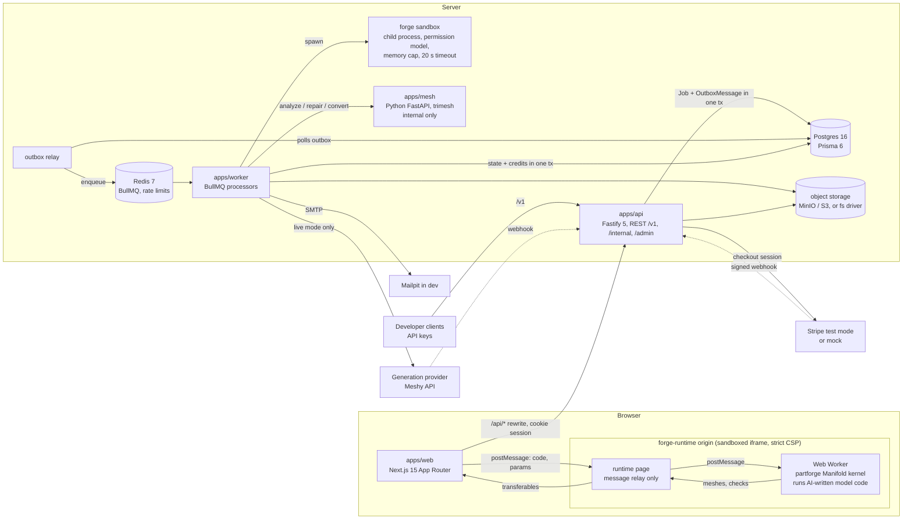

# Architecture

## Overview



## Packages

| Path | Responsibility |
| --- | --- |
| `apps/web` | Next.js 15 (App Router), React 19, Tailwind v4, brand-styled shadcn-pattern components. Calls the API through a same-origin `/api/*` rewrite. |
| `apps/api` | Fastify 5. REST API for the web app and the public developer API under `/v1`; `/internal/*` signature-checked webhooks; `/admin/*` role-gated, audited routes. Serves signed file URLs for the fs storage driver. |
| `apps/worker` | Node 22 BullMQ processors: `generation`, `forge-build`, `mesh-analysis`, `print-quote`, `email`, `reaper`, plus the outbox relay. |
| `apps/mesh` | Python FastAPI service (internal only): analyze, repair, convert (STL/OBJ/3MF/GLB), remesh, and the print estimator inputs. No slicer (rule 6). |
| `apps/forge-runtime` | Vite app that hosts the browser forge sandbox: a relay page loaded in a sandboxed cross-origin iframe, and the Web Worker that evaluates model code with partforge. partforge requires a Vite consumer, which is why this is its own app (ADR-008). `dev` runs a watch build served with the production CSP (ADR-024). |
| `packages/db` | Prisma 6 schema, migrations, seeds, owner-scoped repositories, SQL for triggers and partial/trigram indexes. |
| `packages/shared` | Zod schemas (single source for API contracts and `openapi.yaml`), error codes, ID prefixes (UUIDv7), state machines, money utilities. |
| `packages/forge-kit` | Thin wrapper over `partforge`: model-code contract, schema extraction, parameter validation and clamping, static import check, sandbox runners (Node child process and browser worker), DFM checks, starter forges, `MockAuthor`. |
| `packages/pricing` | Pure pricing and print-estimate functions, versioned JSON config, golden fixtures. Runs in the browser (estimates) and on the server (authoritative). |
| `packages/providers` | `ModelProvider` interface, `MockProvider`, `MeshyProvider` (live), `PrintPartner` interface and `MockPartner`, `MockCarrier`. |
| `packages/ui` | Design tokens and shared components, including the three.js viewer used for forges, generated models, and print previews. |
| `packages/storage` | Storage drivers: `fs` (local disk with HMAC-signed URLs served by the API's `/files/*` route) and `s3` (MinIO / S3 presigned URLs). |
| `e2e` | Playwright journeys (J1–J8) against the running stack. `pnpm e2e`. |
| `packages/config` | Shared tsconfig, ESLint flat config, Prettier config, and the Zod environment schema. |

## Request and job flow

1. A POST that creates work (forge, generation, quote, order) requires `Idempotency-Key`.
   The API validates input with the shared Zod schema, reserves credits (when the job
   costs credits), and writes the `Job` row, the `CreditLedger` reservation row, and an
   `OutboxMessage` in **one transaction** (ADR-004, ADR-005).
2. The outbox relay reads unpublished outbox rows with `FOR UPDATE SKIP LOCKED`, enqueues
   them on BullMQ with the job ID as the BullMQ job ID (so a re-publish is a no-op), and
   marks them published.
3. A worker processor claims the job (`locked_by`, `locked_at`), moves it through the job
   state machine, and on a terminal state commits or releases credits **in the same
   transaction** as the status change. Every transition writes a `JobEvent` row.
4. Clients follow progress with `GET /v1/jobs/:id/events` (SSE, `Last-Event-ID` resumes
   from the next `JobEvent` sequence number).
5. The reaper releases reservations older than the job timeout plus one hour and fails
   their jobs.

## Forge pipeline

```mermaid
sequenceDiagram
  participant U as User
  participant API
  participant W as forge-build worker
  participant A as Author (MockAuthor | LLM)
  participant S as Sandbox child process
  U->>API: POST /v1/forges {prompt}
  API->>API: reserve credits, Job FORGE_BUILD, outbox
  W->>A: author(prompt, context)
  A-->>W: model.js
  W->>W: static check (AST import allowlist + denylist)
  W->>S: build + verify (20 s, memory cap, no fs write, no child processes)
  alt failure
    W->>A: one repair attempt with the error text
    W->>S: rebuild
  end
  S-->>W: schema, measure, checks, STL, thumbnail PNG
  W->>API: Asset FORGE + AssetVersion + ForgeSource + files; commit credits
  U->>U: forge page: live previews in the browser sandbox (no credits)
```

Forge build states: `DRAFT → AUTHORING → STATIC_CHECK → BUILDING → VERIFYING → READY`, any
failure after the single repair attempt → `FAILED`.

## Forge preview protocol (browser)

The forge page creates a hidden iframe on `FORGE_RUNTIME_ORIGIN` and talks to it with
`postMessage` (origins checked on both sides): `load {code}` → `loaded {parameters, defaults}`;
`build {params}` → `meshes` (transferable typed arrays); `inspect {params}` → `report`
(plain-language checks); `export {format: stl|3mf, params}` → `files`. The relay serializes
requests, coalesces queued builds, and restarts the worker after a 20 s timeout. Parameter
changes rebuild 250 ms after the last change; the last good mesh stays visible.

## Named features and region selection (Module 6)

A forge exports `features`, an object of builder functions, each returning a solid labeled
with its own key; the parts' `build` functions compose them. The kernel carries the labels
through booleans, so every triangle of the preview mesh names its feature
(`featureIds`/`features` on each mesh, forwarded by the runtime relay). The server build
step (sandbox) also returns each feature's view-frame bounds, and the worker stores one
`ForgeFeature` row per feature: key, sub-part, source range of the builder, parameters it
reads, and bounds.

Selecting an area: the viewer's select mode turns a click or a dragged circle into up to 200
ray hits (point + the hit triangle's feature label). `POST /v1/forges/:id/region-edits`
resolves them against the version's `ForgeFeature` rows (`resolveSelection`): a label counts
only when its point lies inside that feature's bounds; unlabeled hits count for the features
whose bounds contain them. The winner needs half the votes and twice the runner-up;
otherwise the API answers `409 FEATURE_AMBIGUOUS` with candidates and the person picks one.
A forge without features answers `409 FORGE_NOT_FEATURED`. Edits to a feature replace only
the source range of its builder (`replaceFeature`); everything else stays byte-identical.

### Copilot edits

`PROPOSING → PROPOSED → ACCEPTED | REJECTED | EXPIRED`, or `FAILED`. Credits: reserved on
proposal, committed when the accepted version is saved, released on reject, failure, or
expiry (24 h). The proposal job and the accept job are both `FORGE_BUILD` jobs on the forge
queue (`input.copilot_edit_id` / `input.accept_edit_id`).

## Storage

`STORAGE_DRIVER=fs|s3`. The `s3` driver targets MinIO in `infra/docker-compose.yml` and real
S3 in production, using presigned PUT (15 min) and GET (5 min) URLs. The `fs` driver keeps
files on local disk and issues HMAC-signed URLs to the API's own `/files/*` route with the
same expiries, so local development and CI need no object store (ADR-009). Uploads land
under `quarantine/` and move to `files/` only after the scan passes.

## Environment flags

| Flag | Values | Default |
| --- | --- | --- |
| `PROVIDER_MODE` | `mock`, `live` | `mock` |
| `FORGE_AUTHOR` | `mock`, `llm` | `mock` |
| `SLICER_MODE` | `estimate` (only allowed value until ADR-002b), `real` (refused at boot) | `estimate` |
| `PAYMENTS_MODE` | `mock`, `stripe-test` | `mock` |
| `PARTNER_MODE` | `mock` | `mock` |
| `ESTIMATE_ORDERS` | `block`, `allow-dev` (refused in production) | `block` |
| `STORAGE_DRIVER` | `fs`, `s3` | `fs` |
| `MAIL_DRIVER` | `smtp`, `log`, `memory` | `log` |

`.env.example` documents every variable. `packages/config` validates the environment with
Zod and refuses to boot, listing every missing or invalid key.

## Ports (local)

| Service | Port |
| --- | --- |
| web | 3000 |
| forge-runtime (separate origin for the sandbox) | 3002 |
| api | 4000 |
| mesh | 8000 |
| postgres | 5432 |
| redis | 6379 |
| minio | 9000 / 9001 |
| mailpit | 1025 (SMTP) / 8025 (UI) |
